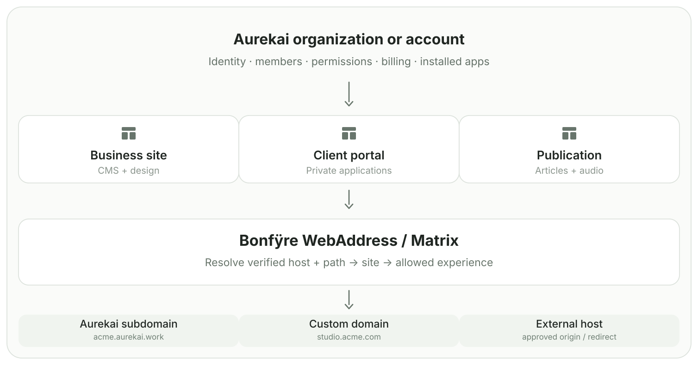
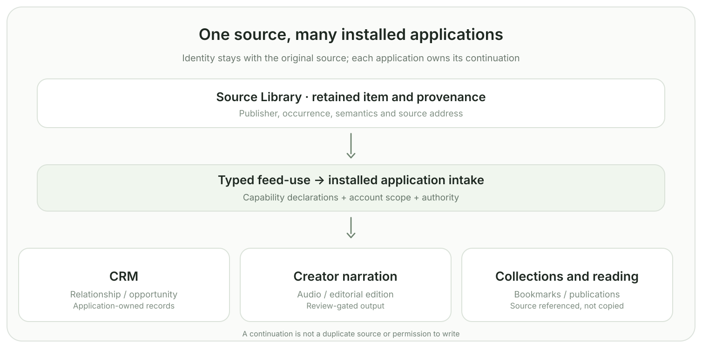
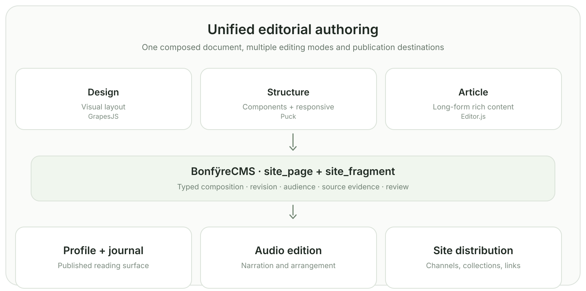
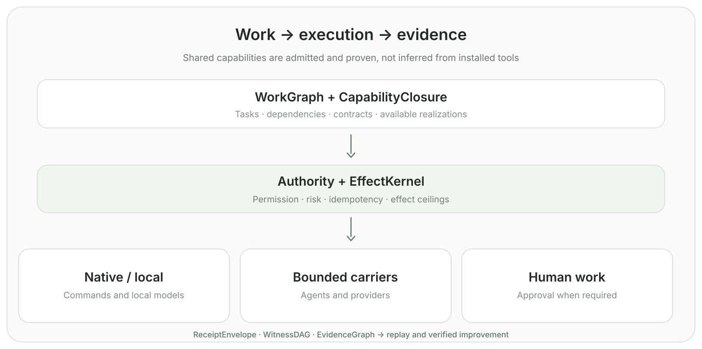

<p align="center">
  
</p>
<h1 align="center">Bonfÿre</h1>

<p align="center">
  <strong>The native software behind Aurekai’s businesses, applications and public network.</strong><br><small>Built on software. Driven by Aurekai.</small>
</p>

<p align="center">
  <a href="#what-the-shared-software-makes-possible">What it does</a> ·
  <a href="#building-blocks">Building blocks</a> ·
  <a href="#federated-workspace">Federated workspace</a> ·
  <a href="https://nickgonzales76017.github.io/bonfyre/modules/">Source libraries (70)</a> ·
  <a href="#start-here">Start here</a> ·
  <a href="#architecture-in-pictures">Visual architecture</a> ·
  <a href="#system-architecture">Architecture</a> ·
  <a href="docs/client-operations-portfolio.md">Client work</a> ·
  <a href="#whats-available-today">Available today</a> ·
  <a href="https://docs.aurekai.work/">Guides</a> ·
  <a href="https://aurekai-work-samples.pages.dev/">Work samples</a> ·
  <a href="https://nickgonzales76017.github.io/bonfyre/about/">About Aurekai</a> ·
  <a href="https://nickgonzales76017.github.io/bonfyre/market.html">Market research</a> ·
  <a href="docs/architecture.md">Architecture</a> ·
  <a href="CONTRIBUTING.md">Contributing</a>
</p>

**Bonfÿre is the software behind Aurekai.** We use it to build websites and applications, work with existing business systems, run local models, connect outside data and coordinate work across the products Aurekai operates.

Aurekai is one operating business that can support many different experiences. A shop can have its own brand and customers. A creator can have a profile, channel and publications. An organization can use CRM, finance, project and service tools. Bonfÿre supplies many of the common pieces while each business keeps the parts that belong to it.

This repository is the technical side of that work. Its native implementation covers Matrix identity and addressing, Source Library, data systems, business application schemas, WorkGraph, agents, Model Commons, media, commerce and public web composition. The public GitHub tree and the locally installed runtime are published on separate schedules.

## What the shared software makes possible

**Independent customer sites.** Our [three-business example](https://docs.aurekai.work/three-businesses) shows how a retailer can get its own website, branding, content and tools while an agency manages several clients using shared infrastructure. That includes separate accounts and customer access, not just changing a page's colors.

**Business applications that talk to one another.** The Frappe-derived app work connects CRM, ERPNext, HRMS, Helpdesk, LMS, Wiki, Drive and Insights schemas to native workspaces. A company can work with relationships, finance, staff and service records without creating a separate integration system for every pair of applications.

**Information that has more than one use.** A job listing can be discovered publicly, continued into an account's CRM and used to prepare a narrated update. A publisher's content can belong to a profile and also appear in a collection or channel. The source stays identifiable while receiving applications manage their own work. These cross-application paths are ongoing product and integration work.

**Products that go beyond a catalogue.** Aurekai's [room planner](https://nickgonzales76017.github.io/bonfyre/spaces/product-room/) and [product configuration workspace](https://nickgonzales76017.github.io/bonfyre/spaces/catalogue/) combine product information, choices, dimensions and spatial layout. Similar source information also supports procurement and business operations.

**Native tools and computation.** The Bonfÿre codebase includes C/Zig-centered commands for data, models, media, workflows, finance and integrations, alongside model runtimes, agents and external backends. A developer can inspect the [technical guide](https://nickgonzales76017.github.io/bonfyre/docs.html) or start with an individual tool.

The larger business model is explained in [Aurekai and Bonfÿre](docs/aurekai-bonfyre-model.md), including how software, engineering time, external resources and distribution become reusable assets across the company.

## Why we're working in these markets

The organizations Aurekai works with already depend on many systems. In the <a href="https://www.uschamber.com/technology/2026-empowering-small-business-report">U.S. Chamber's 2026 small-business survey</a>, 41% of respondents used six or more technology platforms. Our native business-app and integration work helps with that everyday complexity: CRM, finance, inventory, content and operating tools need to work together.

There's also a large base of established websites and published work to build on. <a href="https://w3techs.com/technologies/comparison/cm-wordpress">W3Techs reported WordPress usage at 39.4% of measured websites on November 7, 2026</a>. For a company with years of content, forms, reports and customer history, modernization means carrying that business forward.

For creators, the <a href="https://www.iab.com/blog/2026-iab-creatorfronts-event-recap/">IAB's September 2026 CreatorFronts report</a> projected roughly $44 billion in U.S. creator advertising for 2026 and called for better operational infrastructure around creative work. For AI, <a href="https://hai.stanford.edu/ai-index/2026-ai-index-report/economy">Stanford's 2026 AI Index</a> reported adoption by 88% of surveyed organizations, while deployment of AI agents in particular business functions was still early. Those are useful reasons to build creator tools and native application/agent execution as part of a broader operating platform.

The [market research guide](https://nickgonzales76017.github.io/bonfyre/market.html) links the original publications, dates and specific Aurekai product areas. These are external market indicators, separate from our product and operating results.

## From the journal

The [Aurekai Journal](https://nickgonzales76017.github.io/bonfyre/blog/) now contains **46 published articles**: the original sixteen project essays plus thirty externally grounded investigations, mathematical explainers and responses to specific X posts. They follow the questions behind the software—[building the business around an AI-generated app](https://nickgonzales76017.github.io/bonfyre/blog/why-ai-needs-an-operating-company/), [moving a source into several account applications](https://nickgonzales76017.github.io/bonfyre/blog/a-job-posting-has-more-than-one-job/), [Frappe's application grammars](https://nickgonzales76017.github.io/bonfyre/blog/frappe-as-an-application-language/), and [local model performance](https://nickgonzales76017.github.io/bonfyre/blog/the-memory-wall-in-local-models/).

The editable Markdown lives in [`editorial/posts/`](editorial/posts/). The Pages pipeline uses the dependency-free [`scripts/render-editorial.sh`](scripts/render-editorial.sh) to build the articles, [RSS feed](https://nickgonzales76017.github.io/bonfyre/blog/feed.xml), and stable [post index](editorial/README.md). The public URLs are designed to stay the same when native CMS integration replaces the static builder.

## Aurekai's public network

| Destination | What people find there |
|---|---|
| [aurekai.work](https://aurekai.work) | Businesses, organizations, jobs, professional applications and opportunities |
| [aurekai.life](https://aurekai.life) | People, communities, profiles, collections and publishing |
| [aurekai.live](https://aurekai.live) | Creators, media, recordings, channels and public experiences |
| [aurekai.shop](https://aurekai.shop) | Products, sourcing, offers, catalogues and commerce |

The domains are places to enter Aurekai; businesses and creators can also have independent sites and subdomains. Browse the [product guide](https://nickgonzales76017.github.io/bonfyre/explore.html) for a fuller look at how these systems fit together.

## Use a smaller piece

You can also start without building the whole system:

| Independently scoped source | The job it does | What to inspect |
|---|---|---|
| **[Statement Import](https://github.com/Nickgonzales76017/bonfyre-statement-import)** | Convert normalized bank-statement text into CSV and refuse a result when running balances fail to reconcile | [C source and pack fixtures](https://github.com/Nickgonzales76017/bonfyre-statement-import) |
| **[Agent Trace Verifier](https://github.com/Nickgonzales76017/bonfyre-agent-trace-verifier)** | Evaluate agent-execution evidence through a deterministic, source-addressed receipt with linear-time duplicate-event validation | [Standalone verifier and examples](https://github.com/Nickgonzales76017/bonfyre-agent-trace-verifier) |

Those tools have their own repositories and licenses. For more involved deployments, [the client operations portfolio](docs/client-operations-portfolio.md) shows how local software and public applications fit WordPress, ERPNext, source documents, creator publishing, agency work and commerce. The [operating-products guide](https://docs.aurekai.work/operating-products) describes broader customer and partner applications.

## Federated workspace

The integrated native engine stays here. **69 public companion repositories are now
pinned as real Git submodules**, alongside the existing HVM4 dependency. They
are grouped under [`integrations/federated/`](integrations/federated/) and
[`examples/federated/`](examples/federated/), not added as 69 new root
directories.

**[Browse the source libraries →](https://nickgonzales76017.github.io/bonfyre/modules/)**
Every entry links to its owning GitHub repository and its exact pinned commit,
and identifies whether it is a standalone tool, an older source extraction,
an integration donor, or historical lineage. Gitlinks reference **other**
repositories; GitHub does not index their files as code within this parent
repository. Search within the linked owner repository when you need its source.

| Profile | Modules | What lives there |
|---|---:|---|
| `products` | 2 | Independent Statement Import and Agent Trace Verifier |
| `extractions` | 7 | Earlier native library/CLI extractions, including Lambda Tensors |
| `examples` | 7 | Demonstrations, creator scaffold and the real recipe collection |
| `aurekai` | 12 | The earlier Aurekai platform, native runtime, CI, IDE, data and workflow adapters |
| `frappe` | 9 | Pinned source of Frappe, ERPNext, LMS, HRMS, CRM, Helpdesk, Insights, Wiki and archived Drive |
| `interfaces` | 8 | OpenTUI, MCP Apps, A2UI, json-render, Bubble Tea, Lip Gloss, Ratatui and Ghost design/source references |
| `performance` | 22 | Optional benchmark/reference donors: memory/Arrow, search, incremental engines, Linux edge I/O, model serving |
| `lineage` | 2 | Historical bonfyre-oss and HCP work, deliberately not active runtime replacements |
| `upstream` | 1 | Existing independently maintained HVM4 |

A normal clone remains small and builds without these optional groups. To get
only the separately usable tools:

```bash
git clone https://github.com/Nickgonzales76017/bonfyre.git
cd bonfyre
bash scripts/federated_modules.sh list
bash scripts/federated_modules.sh init products
bash scripts/federated_modules.sh status products
```

Use `init extractions`, `init examples`, or `init aurekai` only for the work
you need. For one specific donor, use `init one integrations/federated/interfaces/opentui`.
The `frappe`, `interfaces`, `performance`, and `all` groups can pull **gigabytes** of source
history and require `BONFYRE_ALLOW_LARGE_MODULES=1` before initializing.
Neither the optional donors nor historical lineage is cloned by default. The script verifies the exact gitlink
commit and public URL before fetching, **never advances to a remote branch
without review**, and recurses only into the reviewed native extraction dependencies.

For any proposed optimization, the [read-only performance equivalence reviewer](scripts/performance_equivalence.mjs) compares source digests, original functionality, exact final outcomes, authorization scope, observed resource effects, priced-provider costs and rollback evidence. A pass requires zero observed false prunes on the trial, exact final-result equality, and independent evidence; it means **eligible for human promotion review**, never deployed, and missing evidence retains the exact baseline. The optional [native physical receipt readback](scripts/performance_physical_receipts.mjs) verifies persisted BonfyreCompress CopyReceipt counters against a read-only SQLite registry (Node 22+), refuses missing records or unequal useful work, and then applies the existing review gate. This readback is **not** owner authority or proof that the upstream counter instrumentation is independently accurate. Owner receipts must still be independently read back; donor benchmarks are not production evidence.

The 22 performance donors are *reference implementations* only: no automatic linking, runtime replacement, no copying third-party assets or new quantization claims. Some are large Rust/Python/C++ systems and some use platform-specific interfaces; `init one integrations/federated/performance/memory/nanoarrow` fetches only one exact pin. Promotion requires compatible licenses, independently measured behavior, full feature parity and a fallback route.

The Frappe pins are source references, **not a tested nine-app compatible bench**;
`frappe/drive` is archived upstream. The interface repos are source/design
references, **not bundled components or an implicit right to reuse assets**.

The CMS, Intake, Pipeline and Embed extraction repos now use pinned
`bonfyre-core` dependencies rather than copying `libbonfyre`; CMS also pins
Lambda Tensors. `init extractions` initializes these small nested dependencies,
while larger donor and historical lineages do not recurse.

These are *references to independently owned source histories*, not a second
owner for Bonfÿre facts or an assertion that old extracted code matches the
live `cmd/` implementation. No private client repository is included.
Review the license in each companion repo separately. The three unusable
archived gitlink coordinates remain documented in their evidence history
rather than blocking normal submodule initialization.

## Building blocks

Bonfÿre spans core native systems and interoperable application families. The repository exposes source and integration boundaries for each:

| Area | What it does | Where it lives |
|---|---|---|
| Data | Local SQL and vector search, with the source of every record kept | [`cmd/BonfyreVec`](cmd/BonfyreVec/), [`cmd/BonfyreEmbed`](cmd/BonfyreEmbed/), [`cmd/BonfyreCMS`](cmd/BonfyreCMS/) |
| Contracts | Typed schemas and the code generated from them | `schemas/control` (in release review) |
| Models | Serving, quantization and embeddings | [`cmd/BonfyreQuant`](cmd/BonfyreQuant/), [`cmd/BonfyreModel`](cmd/BonfyreModel/) |
| Work | Requests, commitments and who may act on them | [`cmd/BonfyreQueue`](cmd/BonfyreQueue/), [`cmd/BonfyreAuth`](cmd/BonfyreAuth/), [`cmd/BonfyreWorkflow`](cmd/BonfyreWorkflow/) |
| Apps | Frappe and WordPress integration | [`integrations/`](integrations/) |
| Media | Preparing and transcribing recordings | [`cmd/BonfyreMediaPrep`](cmd/BonfyreMediaPrep/), [`cmd/BonfyreTranscribe`](cmd/BonfyreTranscribe/) |
| Commerce | Moving records between systems and checking them on arrival | `cmd/BonfyreBridge` (in release review) |
| Finance | Meters, invoices and recorded payments | [`cmd/BonfyreFinance`](cmd/BonfyreFinance/), [`cmd/BonfyrePay`](cmd/BonfyrePay/), [`cmd/BonfyreMeter`](cmd/BonfyreMeter/) |
| Web | Sites, pages and the assistant endpoint for each | `cmd/BonfyreWebAddress` (in release review), `components/BonfyreServiceSite` (in release review) |

The [building blocks guide](https://docs.aurekai.work/building-blocks) says
where to start with each, and the
[local-first guide](https://docs.aurekai.work/local-first-applications)
walks through the data area. Known limits are written down rather than hidden:
a vector store is made at one width (`bonfyre-vec init store.db --dims 768`),
and changing embedding model means making a new store.

## How it is put together

Underneath, the **Matrix** represents each subject once and connects its
addresses, public presence, relationships, institutions, state, economics,
compute, external participation and interfaces. Identity, authority,
capability, work, effects, evidence, resources and commitments each have a
separate owner.

Bonfÿre also supplies execution history, simulation and optimization capabilities for Aurekai's operating programs. These sit alongside the application, media, commerce, finance and public experience systems.

The Generation-10/V8.1 system map is the architectural basis. The architecture Atlas records component ownership, implementations, measurements and development work across the native estate.

## Architecture in pictures

<p align="center">
  <a href="docs/architecture-visuals/README.md">
    
  </a>
</p>

An Aurekai account can operate more than one website or application. **The site owns its content and capabilities; the address points to that site.** This is the existing native separation between CMS site identity, Matrix addressing and presentation. General-purpose custom-domain enrollment, sub-organization delegation, and external-origin proxying remain separately gated extensions—not features implied by this illustration.

<table>
  <tr>
    <td width="33%" align="center">
      <a href="docs/architecture-visuals/README.md#2-one-source-many-installed-applications"></a>
      <p><strong>One source, many applications</strong></p>
      <p>Installed app intake and source-owned provenance.</p>
    </td>
    <td width="33%" align="center">
      <a href="docs/architecture-visuals/README.md#3-editorial-composition-and-publication"></a>
      <p><strong>Editorial composition</strong></p>
      <p>One document; distinct editing and publication steps.</p>
    </td>
    <td width="33%" align="center">
      <a href="docs/architecture-visuals/README.md#4-work-execution-and-proof"></a>
      <p><strong>Work and evidence</strong></p>
      <p>Authority before effects, receipts after execution.</p>
    </td>
  </tr>
</table>

**[Explore all six architecture views](docs/architecture-visuals/README.md)** — sites and domains, feed-to-app continuations, editorial publishing, work and proof, nine business-application grammars, and catalogue-to-room-planning commerce. The [canonical Atlas](architecture/README.md) supplies maturity and source evidence behind these visual summaries.

## System architecture

```text
intent / observation / foreign state
                 │
                 ▼
 Subject · AddressConstellation · Presence · Authority
                 │
                 ▼
 Bonfÿre Matrix · CapabilityClosure · WorkGraph
                 │
       ProviderGraph · Context · Resources · MoneyGraph
                 │
                 ▼
 EffectKernel · AgentSession · native/local/external realization
                 │
                 ▼
 ReceiptEnvelope · WitnessDAG · EvidenceGraph
                 │
                 ▼
 replay · shadow · simulation · backtesting
                 │
                 ▼
       Aurekai: apps · networks · programs · commerce
```

Each part has a defined responsibility:

| Organ | What it owns |
|---|---|
| **Bonfÿre Matrix** | Stable semantic subjects, address constellations, publication presences, and recursively delegated institutional topology. |
| **WorkGraph** | Durable missions, dependencies, leases, cooling, and completion contracts. |
| **CapabilityClosure** | The gap between a named capability, a callable realization, and a workload-proven one. |
| **Authority + EffectKernel** | Who may do what, with idempotency and effect ceilings checked at execution time. |
| **Contract Projection Kernel v2** | ActiveClosure-demanded projections into native ABIs, data/query forms, APIs, WIT/Wasm, Frappe surfaces, evidence, evolution, tests, and packs. |
| **Evidence and replay** | Receipts, witness DAGs, trace divergence, proof bundles, deterministic replay, shadow execution, simulation, and institutional backtesting. |
| **Optimization & learning** | Discover improvements, run simulations, backtest, evaluate, and update reusable execution strategies. Aurekai is the operating business that consumes these capabilities. |

### Capability programs

The Generation-10 architecture preserves **91 Power identities**. Each identity moves through a
maturity ladder—defined, implemented, built, resolvable, health-probed,
workload-proven, quality-proven, promoted—so discovery never becomes a false
claim of callability. Native commands, libraries, local models, agent carriers,
distributed providers, and humans are realizations selected under capability,
cost, resource, risk, and authority constraints.

### Nine institutional product lineages

The Frappe estate is nine connected projections over shared Bonfÿre meaning:

- **Frappe/Core** — DocTypes, forms, permissions, workflows, and reports
- **ERPNext** — accounting, procurement, inventory, and realized value
- **LMS** — learning, assessment, recipes, and credentials
- **HRMS** — human/agent capacity, roles, skills, and availability
- **CRM** — relationships, communications, opportunities, and deal state
- **Helpdesk** — incidents, disputes, missing evidence, and side work
- **Insights** — derived-current operational, cost, risk, and divergence views
- **Wiki** — policy, contract, knowledge, and institutional memory
- **Drive** — artifacts, receipts, evidence, fixtures, packs, and source material

These products donate mature grammars. They do not replace Authority,
WorkGraph, EvidenceGraph, or the shared semantic owners.

### Model Commons and agentic execution

Model Commons preserves distinct model, tokenizer, quantization, inference,
context, retrieval, reasoning, movement, and evaluation specialties. FPQ/FPQx,
QwenFPQ, GGUF, llama.cpp, BitNet, ONNX Runtime, Burn, CubeCL, Metal, CPU, Wasm,
Embed, Vec, SAE, GigaToken, KV passports, and local speech all keep their own
contracts.

An agent run is a routed execution circuit:

```text
WorkNode → AgentProfile → AgentSession → capability/effect frontier
   ├─ native Power or deterministic local tool
   ├─ local model
   ├─ Claude Code / Codex CLI / another bounded carrier
   ├─ distributed or external provider
   └─ human approval or work when genuinely irreducible
                         ↓
             receipt → divergence → evidence → Aurekai
```

Claude and Codex are carrier profiles. They do not own Bonfÿre semantics.

### Partner Commons, operations, and finance

Partner Commons preserves **112 frozen Generation-10 profiles** for external
institutions, tools, protocols, providers, hosts, and distribution systems.
Profiles connect through ForeignTwin, ProviderGraph, Capability, WorkGraph,
SurfaceIR, and evidence boundaries; an integration never gains semantic or
institutional authority merely because it is reachable.

WorkGraph and ResourceGraph track provider readiness, prices, credits, quotas,
freshness, schedules, external tools, artifact packets and worker dependencies.
This is the system's operational metabolism.

Financial metabolism tracks agreements, billing accounts, spend intents, funding
sources, payment instruments, authorization, capture, settlement, refunds,
allocation and ERPNext accounting separately. It keeps quoted prices apart from
payments, provider credits apart from cash, and dashboards apart from the
accounting records they display.

## What's available today

The November 7, 2026 installed native estate and architecture registry report:

| System | Inventory |
|---|---:|
| Native command families | **93** |
| Frappe-derived application schemas | **1,840 DocTypes / 51 modules** |
| WorkGraph | **20,487 nodes / 45,412 edges** |
| Active backend adapters | **14** |
| Architecture Atlas | **556 entries: 346 implemented, 152 measured, 24 declared, 34 architectural** |

These are counts for the installed V6.1.0 estate and architecture registry; the public GitHub source and individual Aurekai deployments may use different revisions. The component Atlas and release workflows track the corresponding implementation states.

Published source currently sits under [`cmd/`](cmd/), [`engine/`](engine/),
[`lib/`](lib/) and [`integrations/`](integrations/).
Historical notebook documents live under
[`evidence/origins/notebook-era/`](evidence/origins/notebook-era/),
not in competing root folders.

## Start here

Customers and agencies can explore the [work samples](https://aurekai-work-samples.pages.dev/)
and the [operating-products guide](https://docs.aurekai.work/operating-products).
To inspect the current public source snapshot:

```bash
git clone https://github.com/Nickgonzales76017/bonfyre.git
cd bonfyre
```

Follow individual component requirements rather than assuming all the
development estate is installable from `main`.

## Read next

- [Client delivery and integration portfolio](docs/client-operations-portfolio.md)
- [Guides](https://docs.aurekai.work/)
- [Work samples](https://aurekai-work-samples.pages.dev/)
- [Architecture overview](docs/architecture.md)
- [Quickstart](QUICKSTART.md)
- [Contributing](CONTRIBUTING.md)

## License

Covered Bonfÿre source is available under the
[PolyForm Shield License 1.0.0](LICENSE). Separately licensed components and
previously distributed versions retain their applicable terms.
