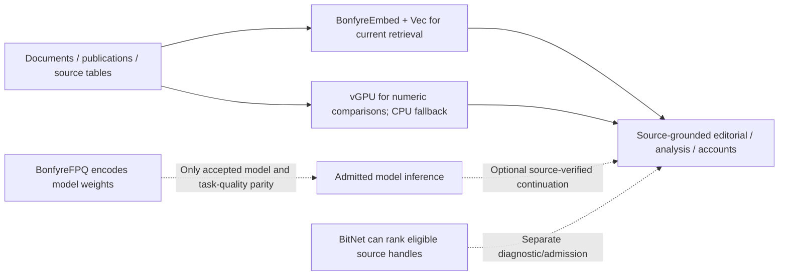

# BonfyreFPQ — Functional Polar Quantization

BonfyreFPQ is the native C implementation of model-weight encoding, reconstruction, diagnostic round trips and algebraic transformation. Weight compression is a **different physical process** from embedding a document, searching the local vector database or running a vGPU numerical kernel over an editorial table. It can reduce model-weight storage/residency **only when a specific model and representation pass actual execution and task parity**.

[How FPQ relates to vGPU, Embed/Vec, BitNet and frontend/editorial](../../docs/native-data-compute-and-presentation.md) · [Native source](src/fpq_native.c) · [Qwen tensor measurement](results/2026-09-11-qwen2.5-coder-0.5b-real-tensor-v9.json)

The previous “~4 bits per weight, 0.9999 cosine” shorthand compressed several distinct experiments into one performance claim. Actual encoded bits/weight, tensor cosine, PPL, task quality, runtime behavior and peak memory **depend on the measured artifact and path**. Preserve the test case and model revision whenever citing a number.

## Where it fits in the downstream work



When a publisher works with a large Parquet corpus or document collection, **FPQ does not accelerate SQL by itself**. SQL/SQLite/DuckDB-Wasm reads and filters source rows; Embed and Vec build/query a model-specific vector index; the vGPU kin kernel computes large pairwise comparisons on its own numeric chart. The frontend renders a bounded, source-linked table and can move reviewed findings into an article, workbook, research report or narration.

A model may later summarize or arrange that material. FPQ would then matter if a particular compressed model has proven layer/logit/generation and task quality at a useful memory/performance envelope. It should not change retrieved source identities, publication rights or the reviewer’s decision. [Representation passport registry](../BonfyreModel/src/main.c) and [ContextCut](../BonfyreContextCut/) are independent admission and context-preparation owners.

## What the proof packs establish

| Source cut | Measured result | Boundary |
|---|---|---|
| [April 2026 proof pack](results/2026-04-10-proof-pack/) | recorded Qwen2.5-0.5B 169 tensors average cosine 0.999783 and a WikiText-2 perplexity change 14.20 → 14.48 (+1.97%) under the stated FPQ v8 test | that pack’s model, representation, task and test configuration; cannot be generalized to v9 or other models |
| [September 2026 Qwen real tensor](results/2026-09-11-qwen2.5-coder-0.5b-real-tensor-v9.json) | one 114,688-weight tensor, 5.75 bits/weight and 0.999935 cosine after v9 roundtrip; 1.23 seconds on the recorded machine | tensor reconstruction only, explicitly **not** layer/logit/generation/task parity |
| [Later FPQ model representation contract](../../architecture/model/fpq.yaff) | native Qwen passthrough baseline and measured factor/quantization variants | all-non-passthrough model execution, quality and residency envelope remain separately required |

The earlier README’s published Hugging Face model table identifies available artifact repositories. It does not certify any of them as admitted Bonfÿre native inference backends at the current release. A BF16 safetensors *format* may load in an external framework while the changed model still needs behavioral testing.

## Full-model acceptance before calling FPQ an optimization

Compare the same source model revision, tokenizer, inputs, layer outputs, logits, task results, generation behavior, memory peaks and throughput across reference and compressed realizations. Model admission is downstream of those results; a successful `roundtrip-v9` does not skip them. Compression cost must also account for decode overhead, placement and repeated-use workloads. The source-side editorial, vGPU and Vec processing remains functional with FPQ held.

## Build

```bash
cd cmd/BonfyreFPQ
make
```

Requires Apple Accelerate (macOS) or OpenBLAS (Linux). No Python. No GPU.

### Linux (RunPod / cloud)

```bash
apt-get install -y libopenblas-dev
make -f Makefile.linux
```

## Quick Start

### Compress a model (safetensors → native .fpq)

```bash
# Full algebra pipeline: LR decomposition + pruning + FPQ encoding
./bonfyre-fpq algebra-compress model.safetensors output.fpq --bits 3 --format fpq

# Convert existing BF16 algebra output → native .fpq
./bonfyre-fpq convert-fpq model.safetensors output.fpq
```

### Compress GGUF models

```bash
./bonfyre-fpq quantize model.gguf compressed.gguf --bits 3
```

### Decompress

```bash
./bonfyre-fpq decompress compressed.fpq output.bin
```

### Roundtrip test (verify quality)

```bash
./bonfyre-fpq roundtrip-v9 model.safetensors --bits 3
```

## Commands

| Command | Description |
|---------|-------------|
| `algebra-compress` | Full pipeline: SVD decompose → prune → correct → FPQ encode |
| `convert-fpq` | Convert BF16 safetensors to native .fpq format |
| `quantize` | Compress and output as GGUF F16 or BF16 safetensors |
| `decompress` | Reconstruct weights from .fpq file |
| `roundtrip-v9` | Compress + decompress + measure quality (testing) |
| `write-v9` | Compress → decode → write BF16 safetensors |
| `inspect` | Print .fpq file stats |
| `algebra-analyze` | Show LR decomposition analysis without compressing |
| `algebra-prune` | Prune weights only |
| `algebra-merge` | Merge two models with alpha blending |

## Using Compressed Models from Hugging Face

All models are at [huggingface.co/NICKO](https://huggingface.co/NICKO).

### Native .fpq files

These are compact compressed files. To reconstruct weights:

```bash
# Download
pip install huggingface_hub
huggingface-cli download NICKO/SmolLM2-1-7B-BonfyreFPQ-Native --local-dir ./smollm2-fpq

# Decompress to usable weights
./bonfyre-fpq decompress ./smollm2-fpq/model.fpq ./smollm2-weights.bin
```

### BF16 safetensors (drop-in replacement)

Some models are also available as standard BF16 safetensors that load directly in PyTorch/diffusers with no special tooling:

```python
from safetensors.torch import load_file
weights = load_file("model.safetensors")
```

## Models on Hugging Face

### Native .fpq format

| Model | Size | Repo |
|-------|------|------|
| Chatterbox | 3.2 GB | [NICKO/chatterbox-algebra-fpq3-BonfyreFPQ-Native](https://huggingface.co/NICKO/chatterbox-algebra-fpq3-BonfyreFPQ-Native) |
| SmolLM2-1.7B | 1.96 GB | [NICKO/SmolLM2-1-7B-BonfyreFPQ-Native](https://huggingface.co/NICKO/SmolLM2-1-7B-BonfyreFPQ-Native) |
| Llasa-8B | 1.7 GB (3/4 shards) | [NICKO/llasa-8b-algebra-fpq3-BonfyreFPQ-Native](https://huggingface.co/NICKO/llasa-8b-algebra-fpq3-BonfyreFPQ-Native) |
| TinyLlama-1.1B | 1.36 GB | [NICKO/TinyLlama-1-1B-BonfyreFPQ-Native](https://huggingface.co/NICKO/TinyLlama-1-1B-BonfyreFPQ-Native) |
| Qwen2.5-3B | 578 MB | [NICKO/qwen2-5-3b-algebra-fpq3-BonfyreFPQ-Native](https://huggingface.co/NICKO/qwen2-5-3b-algebra-fpq3-BonfyreFPQ-Native) |
| Whisper V3 Turbo | 208 MB | [NICKO/openai-whisper-large-v3-turbo-BonfyreFPQ-Native](https://huggingface.co/NICKO/openai-whisper-large-v3-turbo-BonfyreFPQ-Native) |
| Whisper V3 (algebra) | 203 MB | [NICKO/whisper-large-v3-algebra-fpq3-BonfyreFPQ-Native](https://huggingface.co/NICKO/whisper-large-v3-algebra-fpq3-BonfyreFPQ-Native) |
| F5-TTS (algebra) | 156 MB | [NICKO/f5-tts-algebra-fpq3-BonfyreFPQ-Native](https://huggingface.co/NICKO/f5-tts-algebra-fpq3-BonfyreFPQ-Native) |

### BF16 safetensors (drop-in)

| Model | Repo |
|-------|------|
| Whisper V3 Turbo | [NICKO/whisper-large-v3-turbo-BonfyreFPQ3](https://huggingface.co/NICKO/whisper-large-v3-turbo-BonfyreFPQ3) |
| F5-TTS (algebra) | [NICKO/F5-TTS-BonfyreAlgebra-FPQ3](https://huggingface.co/NICKO/F5-TTS-BonfyreAlgebra-FPQ3) |
| Qwen2.5-3B (algebra) | [NICKO/Qwen2.5-3B-BonfyreAlgebra-FPQ3](https://huggingface.co/NICKO/Qwen2.5-3B-BonfyreAlgebra-FPQ3) |

[View all 24 repos →](https://huggingface.co/NICKO)

## Verified Quality

All numbers from reproducible benchmarks in [results/2026-04-10-proof-pack/](results/2026-04-10-proof-pack/).

| Model | Tensors | Avg Cosine | Worst Cosine | PPL Δ |
|-------|---------|------------|--------------|-------|
| Wan2.1-T2V-1.3B | 307 | 0.999874 | 0.999590 | — |
| Qwen2.5-0.5B | 169 | 0.999783 | 0.999588 | +1.97% |
| Whisper base.en | sampled | 0.999808 | 0.999763 | — |

### Perplexity (Qwen2.5-0.5B, WikiText-2)

| Method | PPL | Δ Baseline |
|--------|-----|-----------|
| Baseline (FP32) | 14.20 | — |
| **BonfyreFPQ v8 @3-bit** | **14.48** | **+1.97%** |
| HQQ @3-bit (group=64) | 32.38 | +128% |
| BonfyreFPQ v4 @3-bit | 35.59 | +151% |

## Architecture

v9 unified multiscale pipeline: LR(INT8) + E8 lattice + RVQ + QJL + Ghost correction.

15 C source files, ~5000 lines total. Single binary, no dependencies beyond BLAS.

## License

MIT
