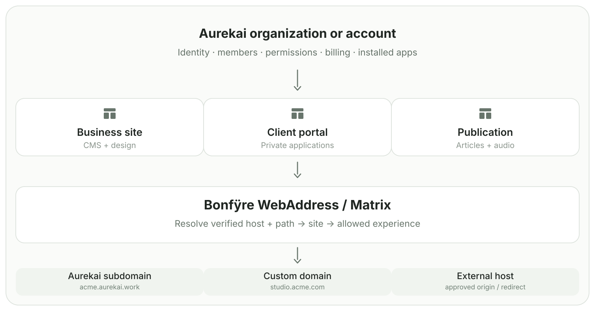
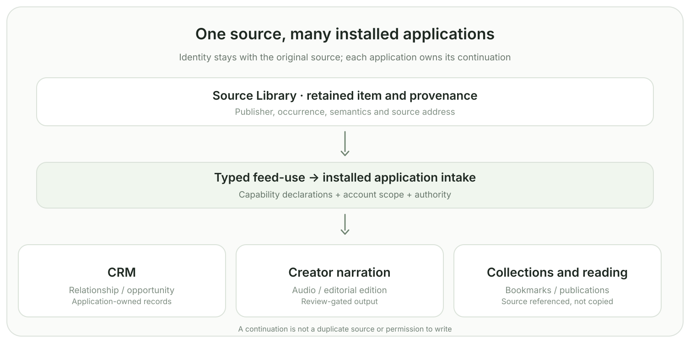
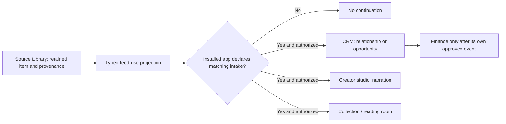
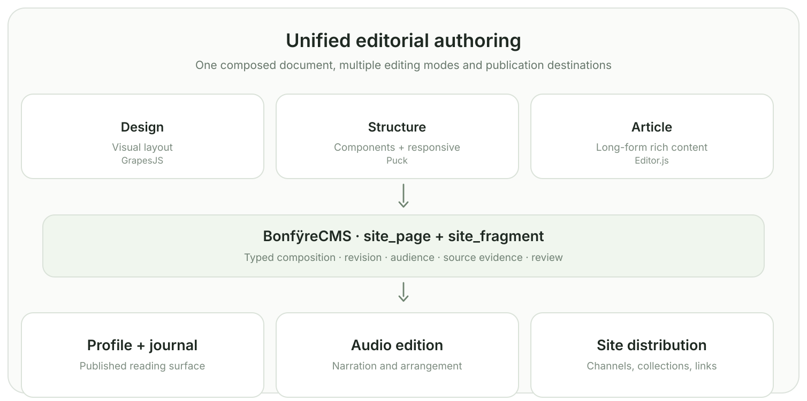
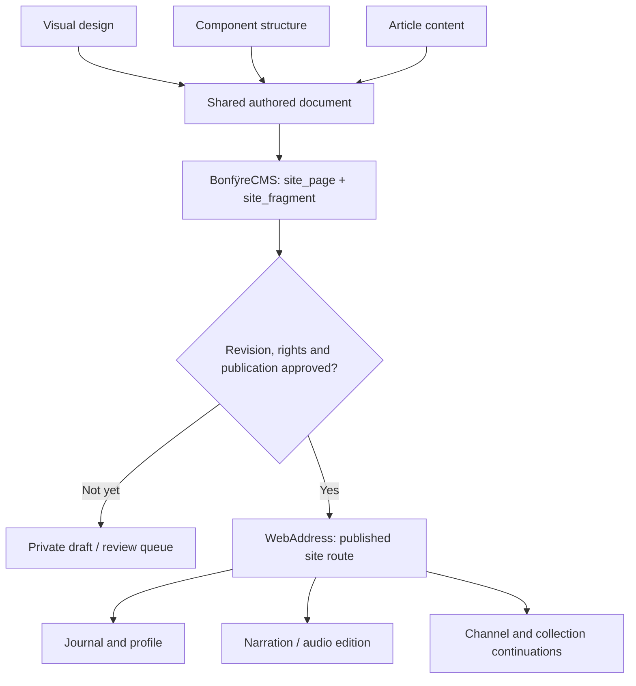
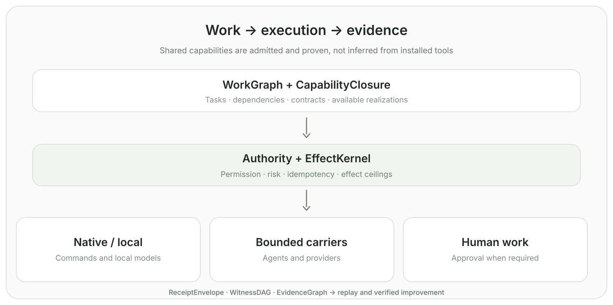
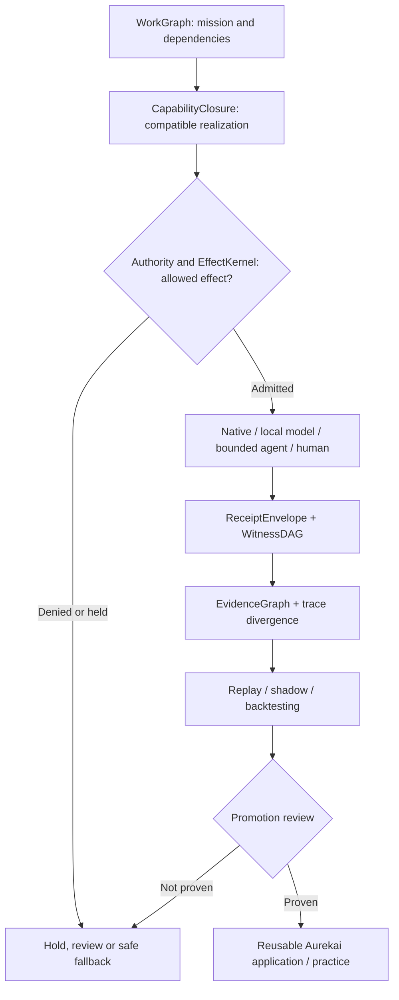
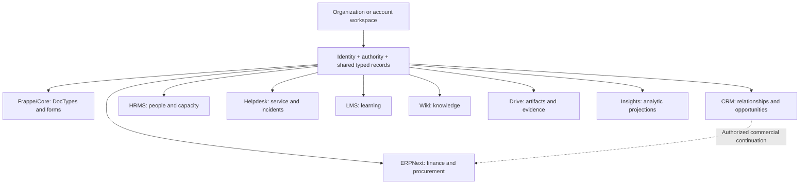
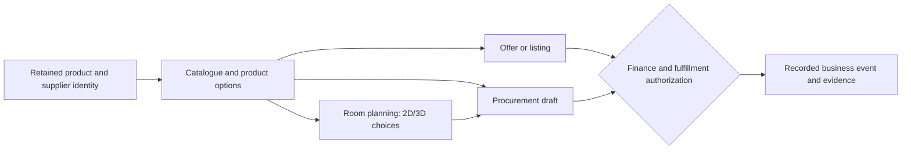

# Bonfÿre architecture, in pictures

Native vector diagrams of how Aurekai experiences compose over Bonfÿre. These are **views of system owners**, not independent architecture registries or proof that every pictured workflow is deployed. The canonical [Architecture Atlas](../../architecture/README.md) and its witnesses remain authoritative.

## 1. Organizations, sites and domains

**One identity can operate many distinct sites.** A business site, client portal and publication may share an account and installed applications while retaining separate content, policies, presentation and publication state. A domain is an *address for a site*, not a second organization or a substitute for a site ID.

**Grounded now:** [site_presentation](../../cmd/BonfyreCMS/content-types/site_presentation.json) records site ID, host, subject, territory and profile; [site_program](../../cmd/BonfyreCMS/content-types/site_program.json) declares application/capability composition. [subject_address.c](../../cmd/BonfyreWebAddress/src/subject_address.c) resolves a host to a published subject. WebAddress and Matrix maintain separate publication and address checks.

**Extension, not yet a verified general-purpose feature:** multiple host aliases and delegated organization/client sub-sites, custom-domain proof and TLS lifecycle, redirects, approved external origins, and nested client billing. These belong to explicit address bindings attached to the existing site/subject, not duplicate site presentations or separate Nginx blocks per client.

| Site/address mode | Outcome | Constraint |
|---|---|---|
| Aurekai subdomain | Serve a native site at a verified hostname | Matrix host + territory + audience must agree |
| Verified custom domain | Serve the same site at a customer hostname | Prove control; provision TLS; select canonical URL |
| Redirect | HTTP 301/302 to an explicit destination | Route policy, query preservation and loop prevention |
| Approved external origin | Hand off or proxy an external application | Allowlist, origin isolation and identity boundary |
| Private preview | Inspect draft content through an authenticated route | Never infer publication from a working URL |

Practical default: use **acme.aurekai.work** for an independent brand; use **/team**, **/journal**, **/clients** and **/apps** for sections inside that site. A child organization gets a separate subject and authority boundary when it owns its own members, records or obligations—not just because a navigation item is nested.

## 2. One source, many installed applications

One source identity can support different applications without repeated imports. Each receiving app owns its derived records and actions. A compatible intake is **not** evidence of a completed CRM write, published audio or a financial transaction. Source admission, installed capabilities and effect permission stay separate.

Related contracts: [capability programs](../../cmd/BonfyreCMS/content-types/capability_program.json), [site programs](../../cmd/BonfyreCMS/content-types/site_program.json), [business and applications model](../aurekai-bonfyre-model.md).

## 3. Editorial composition and publication

Design, structure and article content should compose **one document**, not three island editors or static imports. CMS retains the page/fragment coordinates, audience and status. An editor preview is not a public release. Narration is another edition of the article, not a competing canonical post.

Implementation references: [site fragments](../../cmd/BonfyreCMS/content-types/site_fragment.json), [profile publisher](../../cmd/BonfyreWebAddress/src/profile_home.h), [Pages runtime](../pages-runtime.md). Editor integration and personal-domain rollout have separate verification gates; this graphic does not assert that every site is live.

## 4. Work, execution and proof

An installed command is not a proven capability. A receipt is evidence of an occurrence, not universal proof of correctness. Agent providers are bounded carriers; they do not own semantic work or effects. The [Atlas](../../architecture/README.md) records maturity and witnesses separately from these collapsed views.

## 5. Business application family

Nine Frappe-derived application grammars can share typed business meaning without sharing unrestricted access. Their presence in the code is not a claim of complete runtime write-back. See [Frappe ×9](../architecture.md#frappe-9) and [federated sources](../../integrations/federated/).

## 6. Product, commerce and spatial work

The same product and options must survive movement between catalogue, room planning and procurement. Price observations, quotes, orders and settled payments are different facts. See [commercial operating model](../aurekai-bonfyre-model.md).

---

**Diagram rule:** name its semantic owner, source reference, publication/effect boundary and evidenced maturity. A visual is a navigation aid, not a substitute for native code or a deployed release receipt.
