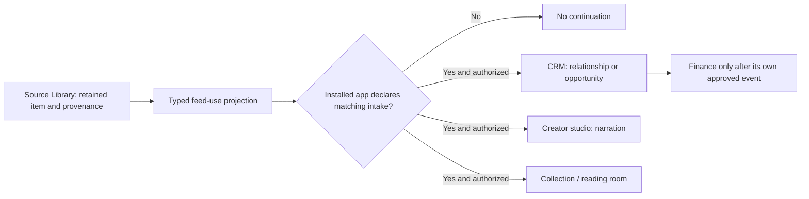
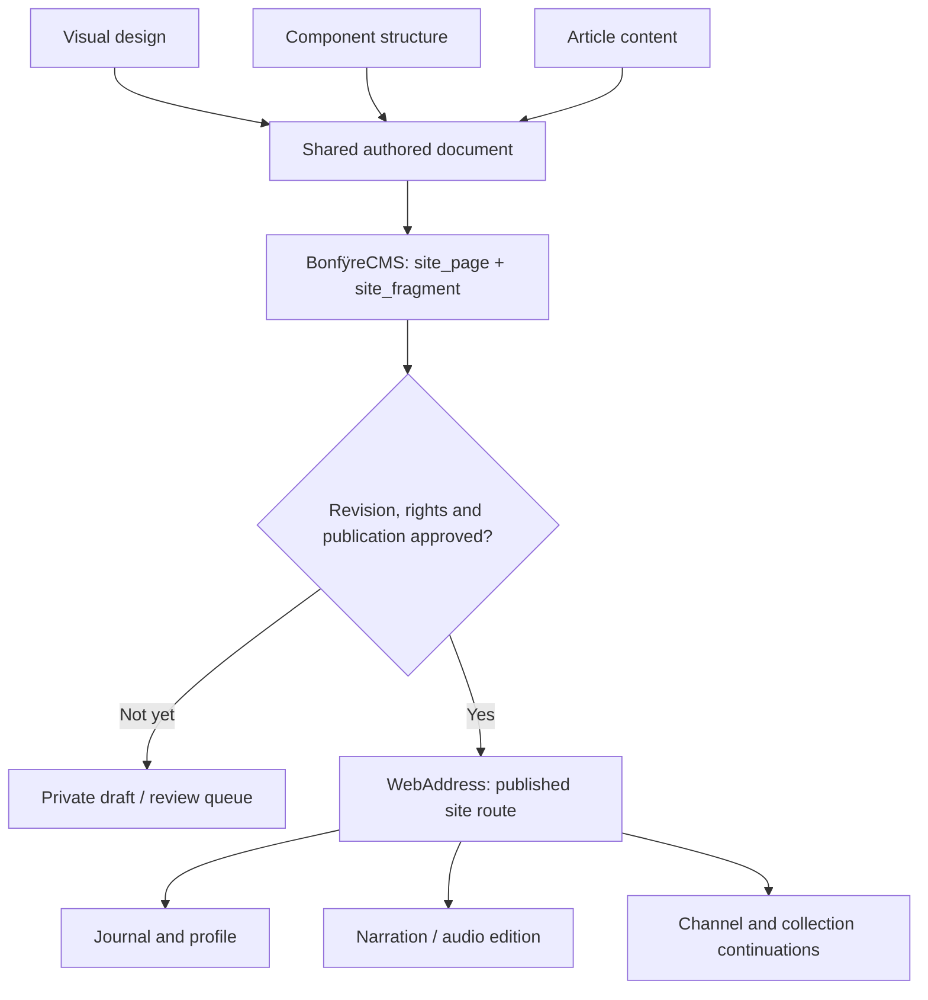
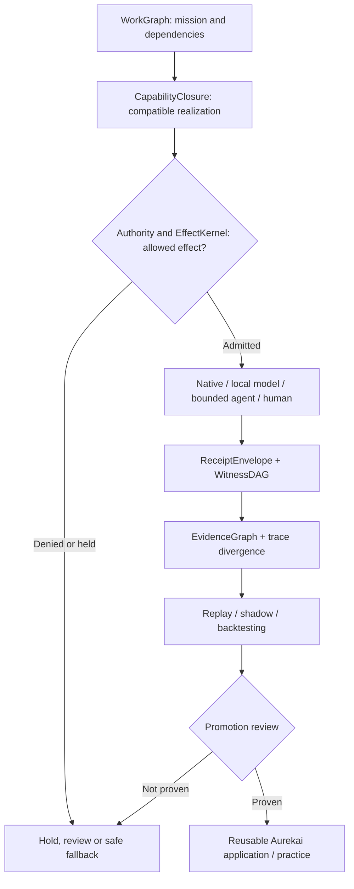
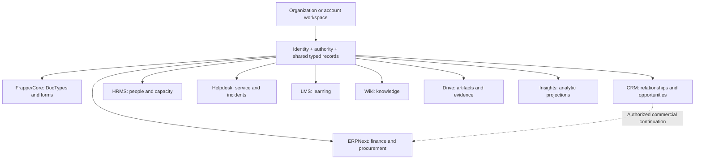
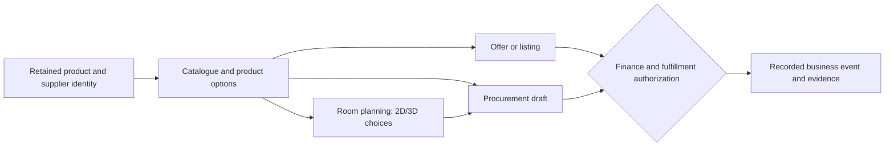

# Bonfÿre architecture, in pictures

These six SVG/Mermaid examples are **Bonfÿre technical drill-downs**, not a mixed inventory of an engine and an operating business. The earlier selection overemphasized domain routing, article narration and a one-off room-planning offer while omitting the general spatial engine, source and provider estate, groups, connections, Git/Forgejo/Josh, BitNet/FPQ, masks, model execution, finance, knowledge, native UI and release/evidence lifecycles.

**[Real workflows and interoperability](../real-workflows-and-interoperability.md)** documents named operations and outputs: WordPress webhooks/WXR, cPanel/InterWorx/Plesk, XLSX, scanned-PDF OCR, DOCX/PDF/EPUB conversion, React/Puck vs unverified Svelte conversion, Project/Workspace/Workbook MCP, YouTube/Patreon/Spotify and Toast. These are not one Matrix pipeline.

**The authoring/frontend foundation has its own [full architecture and innovation guide](../authoring-frontend-architecture.md)**: Puck, GrapesJS, Editor.js, MD4C, Mustach, native C rendering, interaction grammar, responsive tokens, 27 sections, real compiled apps, design references, group/research/public-interest uses and verified gaps.

**Start with the [system-wide architecture and capability index](system-architecture.md)**: 14 native GitHub Mermaid diagrams across the business, identities, institutions, groups, sources, connections, spatial/temporal query, audiovisual media, representation and model computation, Git/source fabric, memory/data, application composition, work/proof, finance, protocols and live delivery. It distinguishes current measured paths, implemented contracts, archived reference implementations, SHADOW/DEFER work, and unverified release claims.

The [source-checked architecture registry](../../architecture/README.md) remains authoritative for exact owners and witnesses. On 2026-11-13 it enumerated 557 architecture entries and 562 interactions across 11 expandable views; **that does not mean 557 shipped applications**.

**Local numerical processing and the authored frontend:** [the two compounding engineering paths](../native-data-compute-and-presentation.md) covers YAFF, CUE, PostCSS `.pcss`, Tailwind/closed tokens, Puck/GrapesJS/Editor.js, native C/MD4C, BonfyreEmbed, BonfyreVec, the vGPU numerical kernels for big source tables, DuckDB-Wasm/Parquet and the separate FPQ/BitNet readiness gates. It includes the 46,376,100 pair vGPU measurement, 109,761-row field, local-only PCSS status and downstream editorial acceptance.

## System-wide views

- **[Full native Mermaid architecture and coverage index](system-architecture.md)** — the entry point for the entire engine and operating business.
- **[Spatial and mapping capabilities](system-architecture.md#5-spatial-geographical-and-temporal-capability--not-a-room-planning-demo)** — observations, valid/knowledge time, indexed queries, public estate field, civic and location-aware applications.
- **[Git, Forgejo, Josh and source ownership](system-architecture.md#8-git-github-forgejo-josh-and-reusable-source-ownership)** — provider-backed repositories, view filtering, source parity and release gates.
- **[Masks, BitNet, FPQ and model admission](system-architecture.md#7-model-representation-masks-bitnet-fpq-and-runtime-placement)** — deterministic eligibility, representation proof and physical execution.
- **[Accounts, groups and connections](system-architecture.md#2-identity-groups-institutions-permissions-and-domains)** — identity and groups; follow through to provider tenancy in section 4.
- **[Work, authority, economics and evidence](system-architecture.md#9-work-autonomy-economics-protocol-boundaries-and-evidence)** — lifecycle and effect boundaries beyond demos.

## Individual system slices (legacy six-view gallery)

## 1. Organizations, sites and domains

**One identity can operate many distinct sites.** A business site, client portal and publication may share an account and installed applications while retaining separate content, policies, presentation and publication state. A domain is an *address for a site*, not a second organization or a substitute for a site ID.

**Grounded now:** [site_presentation](../../cmd/BonfyreCMS/content-types/site_presentation.json) records site ID, host, subject, territory and profile; [site_program](../../cmd/BonfyreCMS/content-types/site_program.json) declares application/capability composition. [subject_address.c](../../cmd/BonfyreWebAddress/src/subject_address.c) resolves a host to a published subject. WebAddress and Matrix maintain separate publication and address checks.

**Extension, not yet a verified general-purpose feature:** multiple host aliases and delegated organization/client sub-sites, custom-domain proof and TLS lifecycle, redirects, approved external origins, and nested client billing. These belong to explicit address bindings attached to the existing site/subject, not duplicate site presentations or separate Nginx blocks per client.

| Site/address mode | Outcome | Constraint |
|---|---|---|
| Aurekai subdomain | Serve a native site at a verified hostname | Matrix host + territory + audience must agree |
| Verified custom domain | Serve the same site at a customer hostname | Prove control; provision TLS; select canonical URL |
| Redirect | HTTP 301/302 to an explicit destination | Route policy, query preservation and loop prevention |
| Approved external origin | Hand off or proxy an external application | Allowlist, origin isolation and identity boundary |
| Private preview | Inspect draft content through an authenticated route | Never infer publication from a working URL |

Practical default: use **acme.aurekai.work** for an independent brand; use **/team**, **/journal**, **/clients** and **/apps** for sections inside that site. A child organization gets a separate subject and authority boundary when it owns its own members, records or obligations—not just because a navigation item is nested.

## 2. One source, many installed applications

One source identity can support different applications without repeated imports. Each receiving app owns its derived records and actions. A compatible intake is **not** evidence of a completed CRM write, published audio or a financial transaction. Source admission, installed capabilities and effect permission stay separate.

Related contracts: [capability programs](../../cmd/BonfyreCMS/content-types/capability_program.json), [site programs](../../cmd/BonfyreCMS/content-types/site_program.json), [business and applications model](../aurekai-bonfyre-model.md).

## 3. Editorial composition and publication — one use of the unified editor

This is **one publishing use** of the [larger native authoring, application and frontend compiler](../authoring-frontend-architecture.md), which also handles community, spatial, source-oriented and typed-application experiences. Design, structure and article content should compose **one document**, not three island editors or static imports. CMS retains the page/fragment coordinates, audience and status. An editor preview is not a public release. Narration is another edition of the article, not a competing canonical post.

Implementation references: [site fragments](../../cmd/BonfyreCMS/content-types/site_fragment.json), [profile publisher](../../cmd/BonfyreWebAddress/src/profile_home.h), [Pages runtime](../pages-runtime.md). Editor integration and personal-domain rollout have separate verification gates; this graphic does not assert that every site is live.

## 4. Work, execution and proof

An installed command is not a proven capability. A receipt is evidence of an occurrence, not universal proof of correctness. Agent providers are bounded carriers; they do not own semantic work or effects. The [Atlas](../../architecture/README.md) records maturity and witnesses separately from these collapsed views.

## 5. Business application family

Nine Frappe-derived application grammars can share typed business meaning without sharing unrestricted access. Their presence in the code is not a claim of complete runtime write-back. See [Frappe ×9](../architecture.md#frappe-9) and [federated sources](../../integrations/federated/).

## 6. A specific offer: product, commerce and room layout

**This is one commercial example, not the definition of spatial computing or Aurekai's mapping capabilities.** For the general spatial owner and its temporal observations, use the [system-wide spatial view](system-architecture.md#5-spatial-geographical-and-temporal-capability--not-a-room-planning-demo). The same product and options must survive movement between catalogue, room planning and procurement. Price observations, quotes, orders and settled payments are different facts. See [commercial operating model](../aurekai-bonfyre-model.md).

---

**Diagram rule:** name its semantic owner, source reference, publication/effect boundary and evidenced maturity. A visual is a navigation aid, not a substitute for native code or a deployed release receipt.
